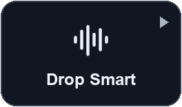
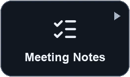
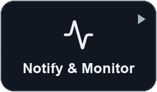

<h1 align="center">Whytap </h1>

  <b>The MacOS productivity app, built for your&nbsp;.</b>

  &nbsp;&nbsp;<a href="https://whytap.ai"><picture><source media="(prefers-color-scheme: dark)" srcset="docs/assets/readme/btn-site-dark.svg"><source media="(prefers-color-scheme: light)" srcset="docs/assets/readme/btn-site-light.svg"></picture></a>

  <b>macOS 14.2+</b> &nbsp;·&nbsp; <b>Apple Silicon &amp; Intel</b> &nbsp;·&nbsp; <b>Developer ID Signed &amp; Notarized</b> &nbsp;·&nbsp; <b>No Account · Zero Telemetry</b> &nbsp;·&nbsp; <b>MIT License</b>

## Watch every tool in action

  
  
  
  
  

  
  
  
  
  

