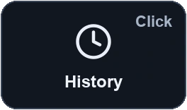
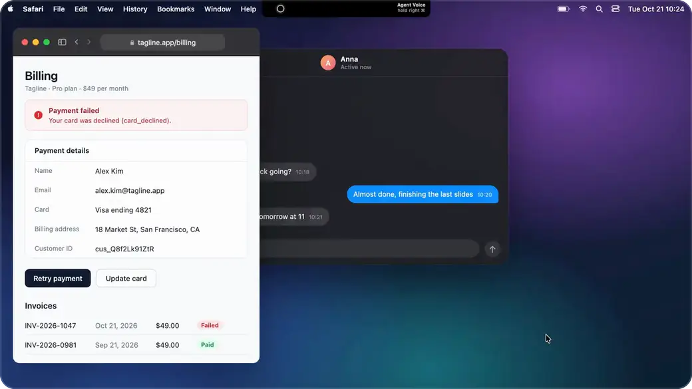

<h1 align="center">Whytap </h1>

  <b>The MacOS productivity app, built for your&nbsp;.</b>

  &nbsp;&nbsp;<a href="https://whytap.ai"><picture><source media="(prefers-color-scheme: dark)" srcset="docs/assets/readme/btn-site-dark.svg"><source media="(prefers-color-scheme: light)" srcset="docs/assets/readme/btn-site-light.svg"></picture></a>

  <b>macOS 14.2+</b> &nbsp;·&nbsp; <b>Apple Silicon &amp; Intel</b> &nbsp;·&nbsp; <b>Developer ID Signed &amp; Notarized</b> &nbsp;·&nbsp; <b>No Account · Zero Telemetry</b> &nbsp;·&nbsp; <b>MIT License</b>

## Watch every tool in action

  
  
  
  
  

  
  
  
  
  

All demos

<b>Case</b>&ensp;API key vault

<b>Approve a command in the notch</b>

<ol>
  <li>Save an API key in Case.</li>
  <li>Request a command from Claude Code, Codex, or Cursor.</li>
  <li>Check the request and choose Allow or Deny.</li>
</ol>

Your coding tool can find key names over MCP. Case passes the secret value to the approved command.

 

<b>Drop Smart</b>&ensp;Dictate a clean prompt

<b>Speak, correct yourself, release</b>

<ol>
  <li>Focus a text field and hold <kbd>Space</kbd>.</li>
  <li>Dictate your prompt, including any corrections.</li>
  <li>Release to paste the cleaned-up text.</li>
</ol>

Fast mode pastes the transcript as you said it. On Apple Silicon you can transcribe on your Mac with Parakeet v3, or use your own speech key.

 

<b>Output Language &amp; Vocab</b>&ensp;Translate speech and teach custom terms

<b>Set up dictation for the way you speak</b>

<ol>
  <li>In Smart mode, choose an Output Language to paste in that language.</li>
  <li>Add project names, jargon, or handles in Vocab so Drop can recognize them.</li>
</ol>

<table>
  <tr>
    <td width="50%" align="center">
      <b>Output Language</b>  
      
    </td>
    <td width="50%" align="center">
      <b>Custom Vocab</b>  
      
    </td>
  </tr>
</table>

<b>Meeting Notes</b>&ensp;Summaries and action items

<b>From a call to the next steps</b>

<ol>
  <li>Choose Take notes when Whytap detects your call.</li>
  <li>Stop recording when the call ends.</li>
  <li>Open the summary and review the action items.</li>
</ol>

Works with Zoom, Google Meet, Teams, and Slack without a bot joining the call. After approval, Claude Code or Codex can read the note and transcript over MCP.

 

<b>Agent</b>&ensp;Ask questions and find files

<b>Get an answer in the notch</b>

<ol>
  <li>Tap your Agent shortcut to type or hold it to speak.</li>
  <li>Ask a question, search the web, or ask for a local file.</li>
  <li>Open or insert the result from the notch.</li>
</ol>
 

<b>Shot</b>&ensp;Edit screenshots and copy text

<b>Capture and edit a region</b>

<ol>
  <li>Open Shot and select an area of the screen.</li>
  <li>Add arrows and labels, or blur sensitive text and numbers.</li>
  <li>Choose Copy text to extract text on your Mac.</li>
</ol>
 

<b>Display Extra</b>&ensp;Boost brightness on HDR displays

<b>Use the display’s available HDR headroom</b>

<ol>
  <li>Open the Display slider in the notch.</li>
  <li>Turn on Extra on a compatible XDR or HDR display.</li>
  <li>Use the slider to adjust brightness.</li>
</ol>
 

<b>Notify &amp; Monitor</b>&ensp;Notch alerts and live dashboards

<b>Keep an eye on your tools</b>

<ol>
  <li>Use Notify to get cards from your coding tool, CI, or scripts.</li>
  <li>Open Monitor to see live dashboards fed by your own data.</li>
</ol>
 

<b>History</b>&ensp;Clipboard, dictations, and answers

<b>Find something you used earlier</b>

<ol>
  <li>Open History in the notch.</li>
  <li>Search for a copy, dictation, or Agent answer.</li>
  <li>Copy it again or paste it where you’re working.</li>
</ol>
 

<b>Calendar &amp; To-do</b>&ensp;Your agenda and tasks in the notch

<b>Check your agenda and manage tasks</b>

<a href="docs/assets/readme/demo-calendar-todo.gif">
  <picture>
    <source media="(prefers-reduced-motion: reduce)" srcset="docs/assets/readme/demo-calendar-todo-still.webp">
    
  </picture>
</a>

