<h1 align="center">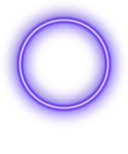&nbsp;Whytap</h1>

<div align="center">

<p align="center">
  <b>The macOS productivity app, built for your&nbsp;.</b>
</p>

<p align="center"></p>

<p align="center">
  <a href="https://github.com/AbsoluteMode/whytap/releases/latest/download/Whytap-latest.dmg"></a>&nbsp;&nbsp;<a href="https://whytap.ai"><picture><source media="(prefers-color-scheme: dark)" srcset="docs/assets/readme/btn-site-dark.svg"><source media="(prefers-color-scheme: light)" srcset="docs/assets/readme/btn-site-light.svg"></picture></a>
</p>

<p align="center">
  <sub><b>macOS 14.2+</b> &nbsp;·&nbsp; <b>Apple Silicon &amp; Intel</b> &nbsp;·&nbsp; <a href="docs/install.md#download-and-open"><b>Developer ID Signed &amp; Notarized</b></a> &nbsp;·&nbsp; <a href="docs/privacy.md"><b>No Account · Zero Telemetry</b></a> &nbsp;·&nbsp; <a href="LICENSE"><b>MIT License</b></a></sub>
</p>

<p align="center">
  <sub>New here? <a href="docs/install.md#first-dictation">Your first dictation in two minutes →</a></sub>
</p>

</div>

## Tools

<details name="tool-demo">
<summary><picture><source media="(max-width: 400px) and (prefers-color-scheme: dark)" srcset="docs/assets/readme/tool-line-drop-smart-phone-dark.svg" width="92%"><source media="(max-width: 400px)" srcset="docs/assets/readme/tool-line-drop-smart-phone-light.svg" width="92%"><source media="(max-width: 640px) and (prefers-color-scheme: dark)" srcset="docs/assets/readme/tool-line-drop-smart-phone-dark.svg" width="94%"><source media="(max-width: 640px)" srcset="docs/assets/readme/tool-line-drop-smart-phone-light.svg" width="94%"><source media="(max-width: 767px) and (prefers-color-scheme: dark)" srcset="docs/assets/readme/tool-line-drop-smart-wide-dark.svg" width="96%"><source media="(max-width: 767px)" srcset="docs/assets/readme/tool-line-drop-smart-wide-light.svg" width="96%"><source media="(max-width: 1011px) and (prefers-color-scheme: dark)" srcset="docs/assets/readme/tool-line-drop-smart-wide-dark.svg" width="95%"><source media="(max-width: 1011px)" srcset="docs/assets/readme/tool-line-drop-smart-wide-light.svg" width="95%"><source media="(max-width: 1279px) and (prefers-color-scheme: dark)" srcset="docs/assets/readme/tool-line-drop-smart-wide-dark.svg" width="96.5%"><source media="(max-width: 1279px)" srcset="docs/assets/readme/tool-line-drop-smart-wide-light.svg" width="96.5%"><source media="(prefers-color-scheme: dark)" srcset="docs/assets/readme/tool-line-drop-smart-wide-dark.svg" width="97.5%"><source media="(prefers-color-scheme: light)" srcset="docs/assets/readme/tool-line-drop-smart-wide-light.svg" width="97.5%">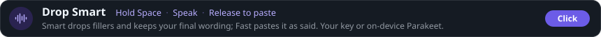</picture></summary>

<p></p>
<p>&emsp;&emsp;
</p>

</details>

<details name="tool-demo">
<summary><picture><source media="(max-width: 400px) and (prefers-color-scheme: dark)" srcset="docs/assets/readme/tool-line-agent-phone-dark.svg" width="92%"><source media="(max-width: 400px)" srcset="docs/assets/readme/tool-line-agent-phone-light.svg" width="92%"><source media="(max-width: 640px) and (prefers-color-scheme: dark)" srcset="docs/assets/readme/tool-line-agent-phone-dark.svg" width="94%"><source media="(max-width: 640px)" srcset="docs/assets/readme/tool-line-agent-phone-light.svg" width="94%"><source media="(max-width: 767px) and (prefers-color-scheme: dark)" srcset="docs/assets/readme/tool-line-agent-wide-dark.svg" width="96%"><source media="(max-width: 767px)" srcset="docs/assets/readme/tool-line-agent-wide-light.svg" width="96%"><source media="(max-width: 1011px) and (prefers-color-scheme: dark)" srcset="docs/assets/readme/tool-line-agent-wide-dark.svg" width="95%"><source media="(max-width: 1011px)" srcset="docs/assets/readme/tool-line-agent-wide-light.svg" width="95%"><source media="(max-width: 1279px) and (prefers-color-scheme: dark)" srcset="docs/assets/readme/tool-line-agent-wide-dark.svg" width="96.5%"><source media="(max-width: 1279px)" srcset="docs/assets/readme/tool-line-agent-wide-light.svg" width="96.5%"><source media="(prefers-color-scheme: dark)" srcset="docs/assets/readme/tool-line-agent-wide-dark.svg" width="97.5%"><source media="(prefers-color-scheme: light)" srcset="docs/assets/readme/tool-line-agent-wide-light.svg" width="97.5%">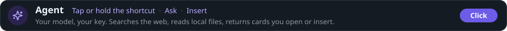</picture></summary>

<p></p>
<p>&emsp;&emsp;
</p>

</details>

<details name="tool-demo">
<summary><picture><source media="(max-width: 400px) and (prefers-color-scheme: dark)" srcset="docs/assets/readme/tool-line-case-phone-dark.svg" width="92%"><source media="(max-width: 400px)" srcset="docs/assets/readme/tool-line-case-phone-light.svg" width="92%"><source media="(max-width: 640px) and (prefers-color-scheme: dark)" srcset="docs/assets/readme/tool-line-case-phone-dark.svg" width="94%"><source media="(max-width: 640px)" srcset="docs/assets/readme/tool-line-case-phone-light.svg" width="94%"><source media="(max-width: 767px) and (prefers-color-scheme: dark)" srcset="docs/assets/readme/tool-line-case-wide-dark.svg" width="96%"><source media="(max-width: 767px)" srcset="docs/assets/readme/tool-line-case-wide-light.svg" width="96%"><source media="(max-width: 1011px) and (prefers-color-scheme: dark)" srcset="docs/assets/readme/tool-line-case-wide-dark.svg" width="95%"><source media="(max-width: 1011px)" srcset="docs/assets/readme/tool-line-case-wide-light.svg" width="95%"><source media="(max-width: 1279px) and (prefers-color-scheme: dark)" srcset="docs/assets/readme/tool-line-case-wide-dark.svg" width="96.5%"><source media="(max-width: 1279px)" srcset="docs/assets/readme/tool-line-case-wide-light.svg" width="96.5%"><source media="(prefers-color-scheme: dark)" srcset="docs/assets/readme/tool-line-case-wide-dark.svg" width="97.5%"><source media="(prefers-color-scheme: light)" srcset="docs/assets/readme/tool-line-case-wide-light.svg" width="97.5%"></picture></summary>

<p></p>
<p>&emsp;&emsp;
</p>

</details>

<details name="tool-demo">
<summary><picture><source media="(max-width: 400px) and (prefers-color-scheme: dark)" srcset="docs/assets/readme/tool-line-meetings-phone-dark.svg" width="92%"><source media="(max-width: 400px)" srcset="docs/assets/readme/tool-line-meetings-phone-light.svg" width="92%"><source media="(max-width: 640px) and (prefers-color-scheme: dark)" srcset="docs/assets/readme/tool-line-meetings-phone-dark.svg" width="94%"><source media="(max-width: 640px)" srcset="docs/assets/readme/tool-line-meetings-phone-light.svg" width="94%"><source media="(max-width: 767px) and (prefers-color-scheme: dark)" srcset="docs/assets/readme/tool-line-meetings-wide-dark.svg" width="96%"><source media="(max-width: 767px)" srcset="docs/assets/readme/tool-line-meetings-wide-light.svg" width="96%"><source media="(max-width: 1011px) and (prefers-color-scheme: dark)" srcset="docs/assets/readme/tool-line-meetings-wide-dark.svg" width="95%"><source media="(max-width: 1011px)" srcset="docs/assets/readme/tool-line-meetings-wide-light.svg" width="95%"><source media="(max-width: 1279px) and (prefers-color-scheme: dark)" srcset="docs/assets/readme/tool-line-meetings-wide-dark.svg" width="96.5%"><source media="(max-width: 1279px)" srcset="docs/assets/readme/tool-line-meetings-wide-light.svg" width="96.5%"><source media="(prefers-color-scheme: dark)" srcset="docs/assets/readme/tool-line-meetings-wide-dark.svg" width="97.5%"><source media="(prefers-color-scheme: light)" srcset="docs/assets/readme/tool-line-meetings-wide-light.svg" width="97.5%">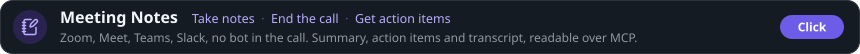</picture></summary>

<p></p>
<p>&emsp;&emsp;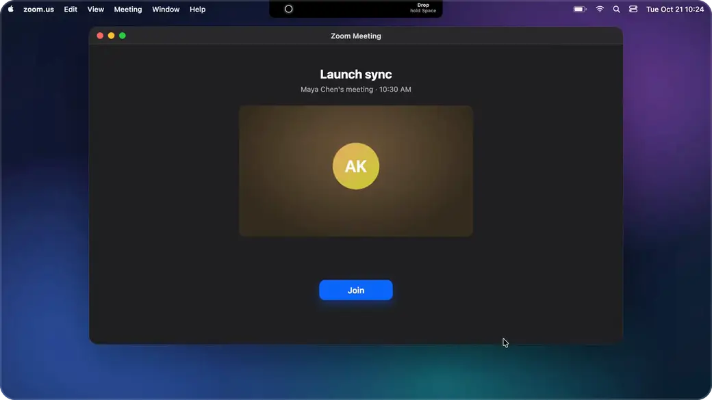
</p>

</details>

<details name="tool-demo">
<summary><picture><source media="(max-width: 400px) and (prefers-color-scheme: dark)" srcset="docs/assets/readme/tool-line-language-vocab-phone-dark.svg" width="92%"><source media="(max-width: 400px)" srcset="docs/assets/readme/tool-line-language-vocab-phone-light.svg" width="92%"><source media="(max-width: 640px) and (prefers-color-scheme: dark)" srcset="docs/assets/readme/tool-line-language-vocab-phone-dark.svg" width="94%"><source media="(max-width: 640px)" srcset="docs/assets/readme/tool-line-language-vocab-phone-light.svg" width="94%"><source media="(max-width: 767px) and (prefers-color-scheme: dark)" srcset="docs/assets/readme/tool-line-language-vocab-wide-dark.svg" width="96%"><source media="(max-width: 767px)" srcset="docs/assets/readme/tool-line-language-vocab-wide-light.svg" width="96%"><source media="(max-width: 1011px) and (prefers-color-scheme: dark)" srcset="docs/assets/readme/tool-line-language-vocab-wide-dark.svg" width="95%"><source media="(max-width: 1011px)" srcset="docs/assets/readme/tool-line-language-vocab-wide-light.svg" width="95%"><source media="(max-width: 1279px) and (prefers-color-scheme: dark)" srcset="docs/assets/readme/tool-line-language-vocab-wide-dark.svg" width="96.5%"><source media="(max-width: 1279px)" srcset="docs/assets/readme/tool-line-language-vocab-wide-light.svg" width="96.5%"><source media="(prefers-color-scheme: dark)" srcset="docs/assets/readme/tool-line-language-vocab-wide-dark.svg" width="97.5%"><source media="(prefers-color-scheme: light)" srcset="docs/assets/readme/tool-line-language-vocab-wide-light.svg" width="97.5%">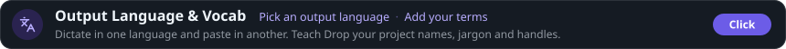</picture></summary>

<p></p>
<p>&emsp;&emsp;

</p>

</details>

<details name="tool-demo">
<summary><picture><source media="(max-width: 400px) and (prefers-color-scheme: dark)" srcset="docs/assets/readme/tool-line-shot-phone-dark.svg" width="92%"><source media="(max-width: 400px)" srcset="docs/assets/readme/tool-line-shot-phone-light.svg" width="92%"><source media="(max-width: 640px) and (prefers-color-scheme: dark)" srcset="docs/assets/readme/tool-line-shot-phone-dark.svg" width="94%"><source media="(max-width: 640px)" srcset="docs/assets/readme/tool-line-shot-phone-light.svg" width="94%"><source media="(max-width: 767px) and (prefers-color-scheme: dark)" srcset="docs/assets/readme/tool-line-shot-wide-dark.svg" width="96%"><source media="(max-width: 767px)" srcset="docs/assets/readme/tool-line-shot-wide-light.svg" width="96%"><source media="(max-width: 1011px) and (prefers-color-scheme: dark)" srcset="docs/assets/readme/tool-line-shot-wide-dark.svg" width="95%"><source media="(max-width: 1011px)" srcset="docs/assets/readme/tool-line-shot-wide-light.svg" width="95%"><source media="(max-width: 1279px) and (prefers-color-scheme: dark)" srcset="docs/assets/readme/tool-line-shot-wide-dark.svg" width="96.5%"><source media="(max-width: 1279px)" srcset="docs/assets/readme/tool-line-shot-wide-light.svg" width="96.5%"><source media="(prefers-color-scheme: dark)" srcset="docs/assets/readme/tool-line-shot-wide-dark.svg" width="97.5%"><source media="(prefers-color-scheme: light)" srcset="docs/assets/readme/tool-line-shot-wide-light.svg" width="97.5%">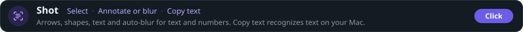</picture></summary>

<p></p>
<p>&emsp;&emsp;
</p>

</details>

<details name="tool-demo">
<summary><picture><source media="(max-width: 400px) and (prefers-color-scheme: dark)" srcset="docs/assets/readme/tool-line-history-phone-dark.svg" width="92%"><source media="(max-width: 400px)" srcset="docs/assets/readme/tool-line-history-phone-light.svg" width="92%"><source media="(max-width: 640px) and (prefers-color-scheme: dark)" srcset="docs/assets/readme/tool-line-history-phone-dark.svg" width="94%"><source media="(max-width: 640px)" srcset="docs/assets/readme/tool-line-history-phone-light.svg" width="94%"><source media="(max-width: 767px) and (prefers-color-scheme: dark)" srcset="docs/assets/readme/tool-line-history-wide-dark.svg" width="96%"><source media="(max-width: 767px)" srcset="docs/assets/readme/tool-line-history-wide-light.svg" width="96%"><source media="(max-width: 1011px) and (prefers-color-scheme: dark)" srcset="docs/assets/readme/tool-line-history-wide-dark.svg" width="95%"><source media="(max-width: 1011px)" srcset="docs/assets/readme/tool-line-history-wide-light.svg" width="95%"><source media="(max-width: 1279px) and (prefers-color-scheme: dark)" srcset="docs/assets/readme/tool-line-history-wide-dark.svg" width="96.5%"><source media="(max-width: 1279px)" srcset="docs/assets/readme/tool-line-history-wide-light.svg" width="96.5%"><source media="(prefers-color-scheme: dark)" srcset="docs/assets/readme/tool-line-history-wide-dark.svg" width="97.5%"><source media="(prefers-color-scheme: light)" srcset="docs/assets/readme/tool-line-history-wide-light.svg" width="97.5%">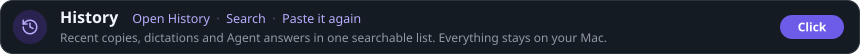</picture></summary>

<p></p>
<p>&emsp;&emsp;
</p>

</details>

<details name="tool-demo">
<summary><picture><source media="(max-width: 400px) and (prefers-color-scheme: dark)" srcset="docs/assets/readme/tool-line-notify-monitor-phone-dark.svg" width="92%"><source media="(max-width: 400px)" srcset="docs/assets/readme/tool-line-notify-monitor-phone-light.svg" width="92%"><source media="(max-width: 640px) and (prefers-color-scheme: dark)" srcset="docs/assets/readme/tool-line-notify-monitor-phone-dark.svg" width="94%"><source media="(max-width: 640px)" srcset="docs/assets/readme/tool-line-notify-monitor-phone-light.svg" width="94%"><source media="(max-width: 767px) and (prefers-color-scheme: dark)" srcset="docs/assets/readme/tool-line-notify-monitor-wide-dark.svg" width="96%"><source media="(max-width: 767px)" srcset="docs/assets/readme/tool-line-notify-monitor-wide-light.svg" width="96%"><source media="(max-width: 1011px) and (prefers-color-scheme: dark)" srcset="docs/assets/readme/tool-line-notify-monitor-wide-dark.svg" width="95%"><source media="(max-width: 1011px)" srcset="docs/assets/readme/tool-line-notify-monitor-wide-light.svg" width="95%"><source media="(max-width: 1279px) and (prefers-color-scheme: dark)" srcset="docs/assets/readme/tool-line-notify-monitor-wide-dark.svg" width="96.5%"><source media="(max-width: 1279px)" srcset="docs/assets/readme/tool-line-notify-monitor-wide-light.svg" width="96.5%"><source media="(prefers-color-scheme: dark)" srcset="docs/assets/readme/tool-line-notify-monitor-wide-dark.svg" width="97.5%"><source media="(prefers-color-scheme: light)" srcset="docs/assets/readme/tool-line-notify-monitor-wide-light.svg" width="97.5%">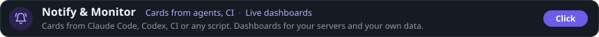</picture></summary>

<p></p>
<p>&emsp;&emsp;
</p>

</details>

<details name="tool-demo">
<summary><picture><source media="(max-width: 400px) and (prefers-color-scheme: dark)" srcset="docs/assets/readme/tool-line-calendar-todo-phone-dark.svg" width="92%"><source media="(max-width: 400px)" srcset="docs/assets/readme/tool-line-calendar-todo-phone-light.svg" width="92%"><source media="(max-width: 640px) and (prefers-color-scheme: dark)" srcset="docs/assets/readme/tool-line-calendar-todo-phone-dark.svg" width="94%"><source media="(max-width: 640px)" srcset="docs/assets/readme/tool-line-calendar-todo-phone-light.svg" width="94%"><source media="(max-width: 767px) and (prefers-color-scheme: dark)" srcset="docs/assets/readme/tool-line-calendar-todo-wide-dark.svg" width="96%"><source media="(max-width: 767px)" srcset="docs/assets/readme/tool-line-calendar-todo-wide-light.svg" width="96%"><source media="(max-width: 1011px) and (prefers-color-scheme: dark)" srcset="docs/assets/readme/tool-line-calendar-todo-wide-dark.svg" width="95%"><source media="(max-width: 1011px)" srcset="docs/assets/readme/tool-line-calendar-todo-wide-light.svg" width="95%"><source media="(max-width: 1279px) and (prefers-color-scheme: dark)" srcset="docs/assets/readme/tool-line-calendar-todo-wide-dark.svg" width="96.5%"><source media="(max-width: 1279px)" srcset="docs/assets/readme/tool-line-calendar-todo-wide-light.svg" width="96.5%"><source media="(prefers-color-scheme: dark)" srcset="docs/assets/readme/tool-line-calendar-todo-wide-dark.svg" width="97.5%"><source media="(prefers-color-scheme: light)" srcset="docs/assets/readme/tool-line-calendar-todo-wide-light.svg" width="97.5%">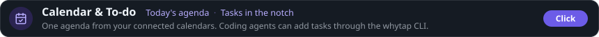</picture></summary>

<p></p>
<p>&emsp;&emsp;<picture><source media="(prefers-reduced-motion: reduce)" srcset="docs/assets/readme/demo-calendar-todo-still.webp"></picture>
</p>

</details>

<details name="tool-demo">
<summary><picture><source media="(max-width: 400px) and (prefers-color-scheme: dark)" srcset="docs/assets/readme/tool-line-display-extra-phone-dark.svg" width="92%"><source media="(max-width: 400px)" srcset="docs/assets/readme/tool-line-display-extra-phone-light.svg" width="92%"><source media="(max-width: 640px) and (prefers-color-scheme: dark)" srcset="docs/assets/readme/tool-line-display-extra-phone-dark.svg" width="94%"><source media="(max-width: 640px)" srcset="docs/assets/readme/tool-line-display-extra-phone-light.svg" width="94%"><source media="(max-width: 767px) and (prefers-color-scheme: dark)" srcset="docs/assets/readme/tool-line-display-extra-wide-dark.svg" width="96%"><source media="(max-width: 767px)" srcset="docs/assets/readme/tool-line-display-extra-wide-light.svg" width="96%"><source media="(max-width: 1011px) and (prefers-color-scheme: dark)" srcset="docs/assets/readme/tool-line-display-extra-wide-dark.svg" width="95%"><source media="(max-width: 1011px)" srcset="docs/assets/readme/tool-line-display-extra-wide-light.svg" width="95%"><source media="(max-width: 1279px) and (prefers-color-scheme: dark)" srcset="docs/assets/readme/tool-line-display-extra-wide-dark.svg" width="96.5%"><source media="(max-width: 1279px)" srcset="docs/assets/readme/tool-line-display-extra-wide-light.svg" width="96.5%"><source media="(prefers-color-scheme: dark)" srcset="docs/assets/readme/tool-line-display-extra-wide-dark.svg" width="97.5%"><source media="(prefers-color-scheme: light)" srcset="docs/assets/readme/tool-line-display-extra-wide-light.svg" width="97.5%">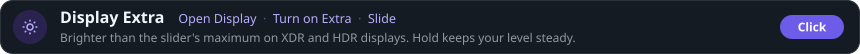</picture></summary>

<p></p>
<p>&emsp;&emsp;
</p>

</details>

## Plugins

<p align="center">Ask <picture><source media="(prefers-color-scheme: dark)" srcset="docs/assets/readme/plugin-harness-claude-code-dark.svg"><source media="(prefers-color-scheme: light)" srcset="docs/assets/readme/plugin-harness-claude-code-light.svg"></picture> or <picture><source media="(prefers-color-scheme: dark)" srcset="docs/assets/readme/plugin-harness-codex-dark.svg"><source media="(prefers-color-scheme: light)" srcset="docs/assets/readme/plugin-harness-codex-light.svg"></picture> to work with Whytap for you.</p>

<p align="center"><picture><source media="(max-width: 640px) and (prefers-color-scheme: dark)" srcset="docs/assets/readme/plugin-grid-phone-dark.svg"><source media="(max-width: 640px)" srcset="docs/assets/readme/plugin-grid-phone-light.svg"><source media="(prefers-color-scheme: dark)" srcset="docs/assets/readme/plugin-grid-wide-dark.svg"><source media="(prefers-color-scheme: light)" srcset="docs/assets/readme/plugin-grid-wide-light.svg">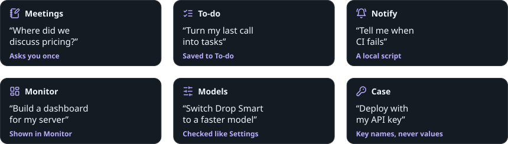</picture></p>

<p><picture><source media="(prefers-color-scheme: dark)" srcset="docs/assets/readme/plugin-harness-claude-code-dark.svg"><source media="(prefers-color-scheme: light)" srcset="docs/assets/readme/plugin-harness-claude-code-light.svg"></picture></p>

```bash
claude mcp add --scope user whytap -- /Applications/Whytap.app/Contents/Helpers/whytap app mcp
claude mcp add --scope user case -- /Applications/Whytap.app/Contents/Helpers/whytap case mcp
```

<p><picture><source media="(prefers-color-scheme: dark)" srcset="docs/assets/readme/plugin-harness-codex-dark.svg"><source media="(prefers-color-scheme: light)" srcset="docs/assets/readme/plugin-harness-codex-light.svg"></picture></p>

```bash
codex mcp add whytap -- /Applications/Whytap.app/Contents/Helpers/whytap app mcp
codex mcp add case -- /Applications/Whytap.app/Contents/Helpers/whytap case mcp
```

<p align="center">Meeting search (the <b>Meetings</b> tile above) is in the next release; the latest release, 2.2.25, does not have it yet.</p>

<p align="center">The second line in each block is Case: it lists key and project names, never values, and using a key still needs your approval. Connect in the Case drawer sets up the same entry for you.</p>

<p align="center">Stuck on setup? Ask Claude Code or Codex for help: with the plugin they read your Whytap settings and switch models, providers, Drop mode and languages for you.</p>

## File an issue in one request

<p align="center">Ask <a href="https://whytap.ai">whytap.ai</a> anything about Whytap. It answers from the code, and when Whytap can't do it yet, it drafts the GitHub issue for you.</p>

<p align="center"><a href="https://whytap.ai">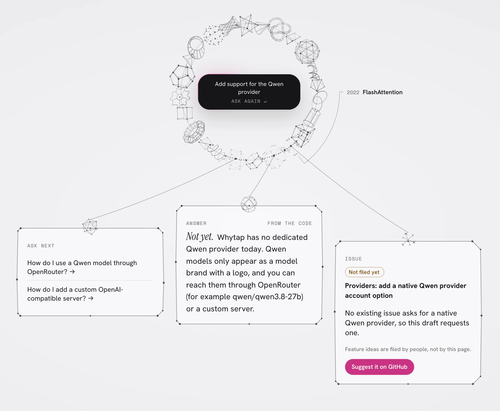</a></p>

## Free to use

<p align="center"><picture><source media="(max-width: 640px) and (prefers-color-scheme: dark)" srcset="docs/assets/readme/free-api-summary-phone-dark.svg"><source media="(max-width: 640px)" srcset="docs/assets/readme/free-api-summary-phone-light.svg"><source media="(prefers-color-scheme: dark)" srcset="docs/assets/readme/free-api-summary-wide-dark.svg"><source media="(prefers-color-scheme: light)" srcset="docs/assets/readme/free-api-summary-wide-light.svg">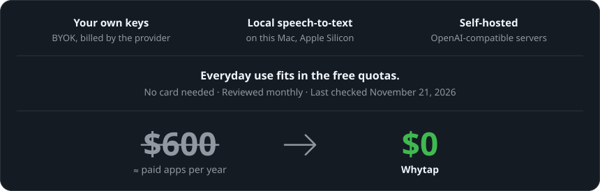</picture></p>

<p align="center">
<a href="https://deepgram.com/pricing"><picture><source media="(max-width: 640px) and (prefers-color-scheme: dark)" srcset="docs/assets/readme/free-api-deepgram-dark.svg"><source media="(max-width: 640px)" srcset="docs/assets/readme/free-api-deepgram-light.svg"><source media="(prefers-color-scheme: dark)" srcset="docs/assets/readme/free-api-deepgram-wide-dark.svg"><source media="(prefers-color-scheme: light)" srcset="docs/assets/readme/free-api-deepgram-wide-light.svg">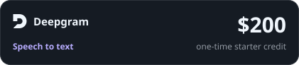</picture></a>
<a href="https://elevenlabs.io/pricing"><picture><source media="(max-width: 640px) and (prefers-color-scheme: dark)" srcset="docs/assets/readme/free-api-elevenlabs-dark.svg"><source media="(max-width: 640px)" srcset="docs/assets/readme/free-api-elevenlabs-light.svg"><source media="(prefers-color-scheme: dark)" srcset="docs/assets/readme/free-api-elevenlabs-wide-dark.svg"><source media="(prefers-color-scheme: light)" srcset="docs/assets/readme/free-api-elevenlabs-wide-light.svg">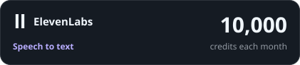</picture></a>
<br>
<a href="https://openrouter.ai/models?max_price=0"><picture><source media="(max-width: 640px) and (prefers-color-scheme: dark)" srcset="docs/assets/readme/free-api-openrouter-dark.svg"><source media="(max-width: 640px)" srcset="docs/assets/readme/free-api-openrouter-light.svg"><source media="(prefers-color-scheme: dark)" srcset="docs/assets/readme/free-api-openrouter-wide-dark.svg"><source media="(prefers-color-scheme: light)" srcset="docs/assets/readme/free-api-openrouter-wide-light.svg">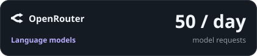</picture></a>
<a href="https://www.tavily.com/pricing"><picture><source media="(max-width: 640px) and (prefers-color-scheme: dark)" srcset="docs/assets/readme/free-api-tavily-dark.svg"><source media="(max-width: 640px)" srcset="docs/assets/readme/free-api-tavily-light.svg"><source media="(prefers-color-scheme: dark)" srcset="docs/assets/readme/free-api-tavily-wide-dark.svg"><source media="(prefers-color-scheme: light)" srcset="docs/assets/readme/free-api-tavily-wide-light.svg">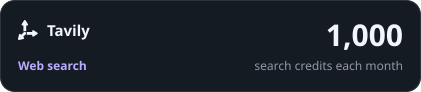</picture></a>
</p>

<p align="center">ElevenLabs' 10,000 free credits a month cover up to 2.5 hours of live dictation on Scribe v3 Live, its most accurate realtime model: about five minutes of speech every day, enough to dictate all month.</p>

## You may also like

<p align="center"><a href="https://github.com/AbsoluteMode/session-recall"><b>Session Recall</b></a><br>Shared memory for Claude Code, Codex and Cursor: find an old decision by meaning across all your agents' chats, with links back to the original turns.</p>

<p align="center"><a href="https://github.com/AbsoluteMode/flora"><b>flora</b></a><br>Workflow contracts for coding harnesses: every step says what proves it is done, and an independent verifier checks that before the next step starts.</p>

<p align="center"><a href="https://github.com/AbsoluteMode/harness-link"><b>Harness Link</b></a><br>One conversation between Codex, Claude Code and Antigravity, plus addressed messages to sessions that are already running.</p>

<p align="center"><b>Orchestrator</b> <sup>soon</sup><br>A Claude Code plugin that puts ten chats into one window: it keeps the task list, starts the sessions and writes to you only when it needs you, when work is ready to check or when the plan changes.</p>

<p align="center"><sub><a href="docs/install.md">Install</a> &nbsp;·&nbsp; <a href="docs/privacy.md">Privacy</a> &nbsp;·&nbsp; <a href="CONTRIBUTING.md#building">Build from source</a> &nbsp;·&nbsp; <a href="CONTRIBUTING.md">Contributing</a> &nbsp;·&nbsp; <a href="SECURITY.md">Security</a></sub></p>
