<h1 align="center">&nbsp;Whytap </h1>

  <b>The MacOS productivity app, built for your&nbsp;.</b>

  &nbsp;&nbsp;<a href="https://whytap.ai"><picture><source media="(prefers-color-scheme: dark)" srcset="docs/assets/readme/btn-site-dark.svg"><source media="(prefers-color-scheme: light)" srcset="docs/assets/readme/btn-site-light.svg"></picture></a>

  <b>macOS 14.2+</b> &nbsp;·&nbsp; <b>Apple Silicon &amp; Intel</b> &nbsp;·&nbsp; <b>Developer ID Signed &amp; Notarized</b> &nbsp;·&nbsp; <b>No Account · Zero Telemetry</b> &nbsp;·&nbsp; <b>MIT License</b>

## Tools

<picture><source media="(max-width: 640px) and (prefers-color-scheme: dark)" srcset="docs/assets/readme/tool-row-drop-smart-phone-dark.svg"><source media="(max-width: 640px)" srcset="docs/assets/readme/tool-row-drop-smart-phone-light.svg"><source media="(prefers-color-scheme: dark)" srcset="docs/assets/readme/tool-row-drop-smart-wide-dark.svg"><source media="(prefers-color-scheme: light)" srcset="docs/assets/readme/tool-row-drop-smart-wide-light.svg">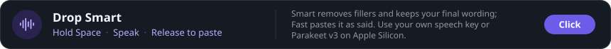</picture>

&emsp;&emsp;

<picture><source media="(max-width: 640px) and (prefers-color-scheme: dark)" srcset="docs/assets/readme/tool-row-agent-phone-dark.svg"><source media="(max-width: 640px)" srcset="docs/assets/readme/tool-row-agent-phone-light.svg"><source media="(prefers-color-scheme: dark)" srcset="docs/assets/readme/tool-row-agent-wide-dark.svg"><source media="(prefers-color-scheme: light)" srcset="docs/assets/readme/tool-row-agent-wide-light.svg">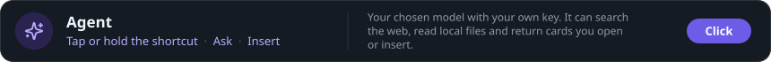</picture>

&emsp;&emsp;

<picture><source media="(max-width: 640px) and (prefers-color-scheme: dark)" srcset="docs/assets/readme/tool-row-case-phone-dark.svg"><source media="(max-width: 640px)" srcset="docs/assets/readme/tool-row-case-phone-light.svg"><source media="(prefers-color-scheme: dark)" srcset="docs/assets/readme/tool-row-case-wide-dark.svg"><source media="(prefers-color-scheme: light)" srcset="docs/assets/readme/tool-row-case-wide-light.svg">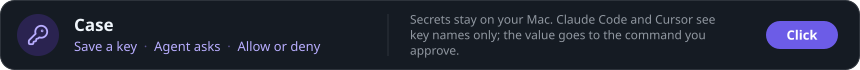</picture>

&emsp;&emsp;

<picture><source media="(max-width: 640px) and (prefers-color-scheme: dark)" srcset="docs/assets/readme/tool-row-meetings-phone-dark.svg"><source media="(max-width: 640px)" srcset="docs/assets/readme/tool-row-meetings-phone-light.svg"><source media="(prefers-color-scheme: dark)" srcset="docs/assets/readme/tool-row-meetings-wide-dark.svg"><source media="(prefers-color-scheme: light)" srcset="docs/assets/readme/tool-row-meetings-wide-light.svg">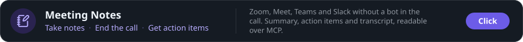</picture>

&emsp;&emsp;

<picture><source media="(max-width: 640px) and (prefers-color-scheme: dark)" srcset="docs/assets/readme/tool-row-language-vocab-phone-dark.svg"><source media="(max-width: 640px)" srcset="docs/assets/readme/tool-row-language-vocab-phone-light.svg"><source media="(prefers-color-scheme: dark)" srcset="docs/assets/readme/tool-row-language-vocab-wide-dark.svg"><source media="(prefers-color-scheme: light)" srcset="docs/assets/readme/tool-row-language-vocab-wide-light.svg">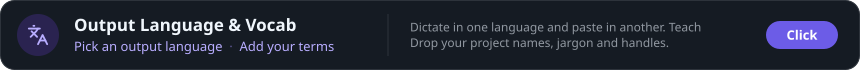</picture>

&emsp;&emsp;

<picture><source media="(max-width: 640px) and (prefers-color-scheme: dark)" srcset="docs/assets/readme/tool-row-shot-phone-dark.svg"><source media="(max-width: 640px)" srcset="docs/assets/readme/tool-row-shot-phone-light.svg"><source media="(prefers-color-scheme: dark)" srcset="docs/assets/readme/tool-row-shot-wide-dark.svg"><source media="(prefers-color-scheme: light)" srcset="docs/assets/readme/tool-row-shot-wide-light.svg">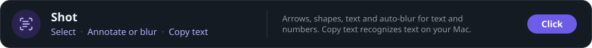</picture>

&emsp;&emsp;

<picture><source media="(max-width: 640px) and (prefers-color-scheme: dark)" srcset="docs/assets/readme/tool-row-history-phone-dark.svg"><source media="(max-width: 640px)" srcset="docs/assets/readme/tool-row-history-phone-light.svg"><source media="(prefers-color-scheme: dark)" srcset="docs/assets/readme/tool-row-history-wide-dark.svg"><source media="(prefers-color-scheme: light)" srcset="docs/assets/readme/tool-row-history-wide-light.svg">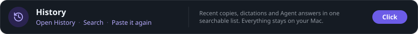</picture>

&emsp;&emsp;

<picture><source media="(max-width: 640px) and (prefers-color-scheme: dark)" srcset="docs/assets/readme/tool-row-notify-monitor-phone-dark.svg"><source media="(max-width: 640px)" srcset="docs/assets/readme/tool-row-notify-monitor-phone-light.svg"><source media="(prefers-color-scheme: dark)" srcset="docs/assets/readme/tool-row-notify-monitor-wide-dark.svg"><source media="(prefers-color-scheme: light)" srcset="docs/assets/readme/tool-row-notify-monitor-wide-light.svg">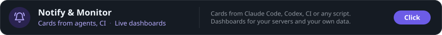</picture>

&emsp;&emsp;

<picture><source media="(max-width: 640px) and (prefers-color-scheme: dark)" srcset="docs/assets/readme/tool-row-calendar-todo-phone-dark.svg"><source media="(max-width: 640px)" srcset="docs/assets/readme/tool-row-calendar-todo-phone-light.svg"><source media="(prefers-color-scheme: dark)" srcset="docs/assets/readme/tool-row-calendar-todo-wide-dark.svg"><source media="(prefers-color-scheme: light)" srcset="docs/assets/readme/tool-row-calendar-todo-wide-light.svg">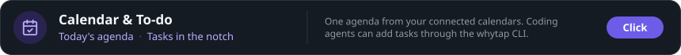</picture>

&emsp;&emsp;<picture><source media="(prefers-reduced-motion: reduce)" srcset="docs/assets/readme/demo-calendar-still.webp">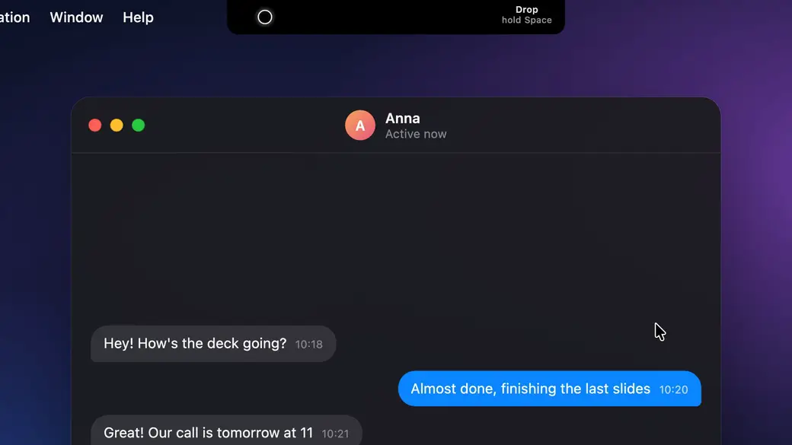</picture>
<picture><source media="(prefers-reduced-motion: reduce)" srcset="docs/assets/readme/demo-todo-still.webp">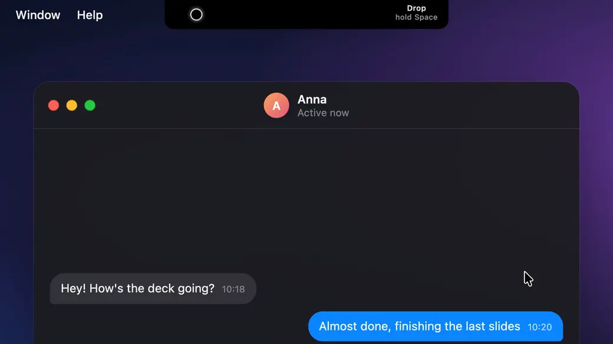</picture>

<picture><source media="(max-width: 640px) and (prefers-color-scheme: dark)" srcset="docs/assets/readme/tool-row-display-extra-phone-dark.svg"><source media="(max-width: 640px)" srcset="docs/assets/readme/tool-row-display-extra-phone-light.svg"><source media="(prefers-color-scheme: dark)" srcset="docs/assets/readme/tool-row-display-extra-wide-dark.svg"><source media="(prefers-color-scheme: light)" srcset="docs/assets/readme/tool-row-display-extra-wide-light.svg">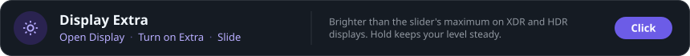</picture>

&emsp;&emsp;

## Free API keys

Whytap is free: you bring the keys. These providers give an allowance without a card,
so you can try Whytap without spending anything. The same list is in
Settings → API & Models → API hints.

Reviewed monthly · Last checked November 21, 2026

| For | Provider | Free allowance | Good to know | Checked |
|---|---|---|---|---|
| Speech to text | [Deepgram](https://deepgram.com/pricing) | **$200** one-time starter credit | Speech recognition credit for new accounts. It does not expire. No card needed to start. | November 21, 2026 |
| Speech to text | [ElevenLabs](https://elevenlabs.io/pricing) | **10,000** free credits each month | The Free plan includes Speech to Text, for non-commercial use with attribution. Speech to Text spends credits per minute of audio. | November 21, 2026 |
| Language models | [OpenRouter](https://openrouter.ai/models?max_price=0) | **50 / day** free model requests | Choose a :free model. Limit: 20 requests a minute; buying $10 of credit once raises the daily limit to 1,000. Tool support and availability vary; agent turns may use several requests. | November 21, 2026 |
| Web search | [Tavily](https://www.tavily.com/pricing) | **1,000** free search credits each month | Web search for Agent. No card required. One basic search uses one credit. Add the Tavily key in API keys. | November 21, 2026 |

Allowances and terms belong to the providers and can change; check the linked page before you rely on one.
