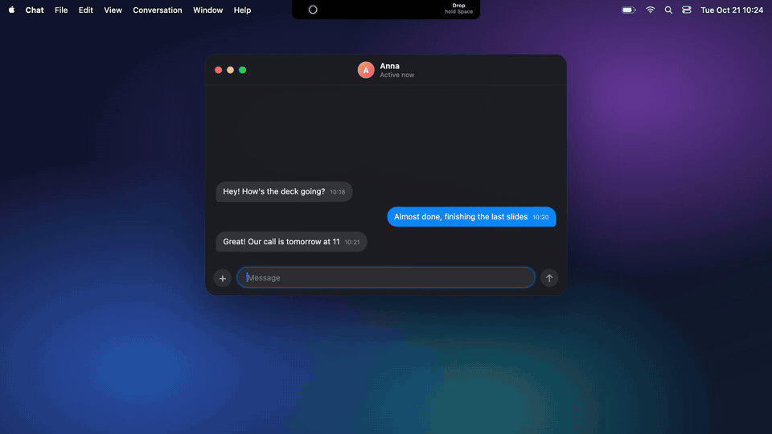

<p align="center">
  
</p>

<h1 align="center">Whytap</h1>

<p align="center">
  <b>Voice input and an AI agent in your Mac's notch.</b><br>
  Bring your own keys. No account, no servers, no telemetry.
</p>

<p align="center">
  <a href="https://github.com/AbsoluteMode/whytap/releases/latest/download/Whytap-latest.dmg"><b>Download</b></a> ·
  <a href="https://whytap.ai">Website</a> ·
  <a href="docs/README.md">Docs</a>
</p>

<p align="center">
  
</p>

## Features

- **Drop**: hold <kbd>Space</kbd> in any text field, speak, release, and the text is pasted at the cursor. Fast pastes the transcript; Smart lightly edits it with your model.
- **Agent**: tap <kbd>Right ⌘</kbd> to type a question or hold it to speak. It reads files, searches the web and answers in the island.
- **Meeting Assistant (pilot)**: get help answering questions during a call using your project's files. Select a Space, type a question or turn on listening to find questions from other participants. Attach screenshots for visual context. [Setup](docs/meeting-assistant.md).
- **Meeting notes**: notices calls in Zoom, Teams, Slack and Google Meet and turns them into a summary with a transcript.
- **History**: your clipboard, dictations and agent answers in one list, ready to paste again.
- **Case**: a secrets vault for Claude Code, Cursor and Whytap Agent. Agents see key names; Case puts the value into the command they run.
- **Shot**: a screenshot editor with arrows, text blur and Copy text.
- **Display Extra**: brighter whites on XDR and HDR displays, beyond the usual maximum.
- **Notify**: notifications from any script your coding agent writes, next to the island.

Also in the island: Translate and live Subtitles, Vocab, To-do, Calendar and Monitor dashboards.

## Your keys, your Mac

- Use your own keys for Soniox, Deepgram, ElevenLabs, OpenRouter, OpenAI or Anthropic, or your own OpenAI-compatible server. Keys stay in the macOS Keychain.
- Audio and text go only to the provider you chose for that feature. There is no Whytap account, backend or telemetry.
- Free and open source under the MIT license.

What leaves your Mac, and when: [Privacy](docs/privacy.md).

## Install

<a href="https://github.com/AbsoluteMode/whytap/releases/latest/download/Whytap-latest.dmg"></a>

macOS 14.2 or newer, Apple Silicon and Intel. Signed and notarized; updates arrive in the island.
More in [Install and update](docs/install.md).

## Quick start

1. Open Whytap. Hover the island at the top of the screen and click **Settings**.
2. In **Permissions**, allow Microphone and Accessibility. In **API & Models**, add a speech key and pick a model for Drop.
3. Click into any text field, hold <kbd>Space</kbd>, speak and release.

| Action | Default |
|---|---|
| Dictate into the focused field | hold <kbd>Space</kbd> |
| Ask the agent by text / by voice | tap / hold <kbd>Right ⌘</kbd> |
| Google the selection / your voice | tap / hold <kbd>Right ⌥</kbd> |
| Start or stop a meeting recording | <kbd>⌥</kbd> <kbd>M</kbd> |
| Close the agent answer | <kbd>Esc</kbd> |

Remap any of them, or give any tool its own shortcut, in **Settings → Hotkeys**.

## Build from source

Needs Xcode 26 or newer (Swift 6).

```bash
git clone https://github.com/AbsoluteMode/whytap.git
cd whytap
swift test
./scripts/dev-run.sh --run
```

[Build details](docs/build-and-release.md) · [Customize Whytap with your coding agent](docs/customization/README.md)

## Contributing

Bug reports and pull requests are welcome; see [CONTRIBUTING.md](CONTRIBUTING.md).

## Security

Report vulnerabilities to security@whytap.ai; see [SECURITY.md](SECURITY.md).

## License

[MIT](LICENSE). The Whytap name and icon: [TRADEMARK.md](TRADEMARK.md). Third-party code: [THIRD_PARTY_LICENSES.md](THIRD_PARTY_LICENSES.md).
