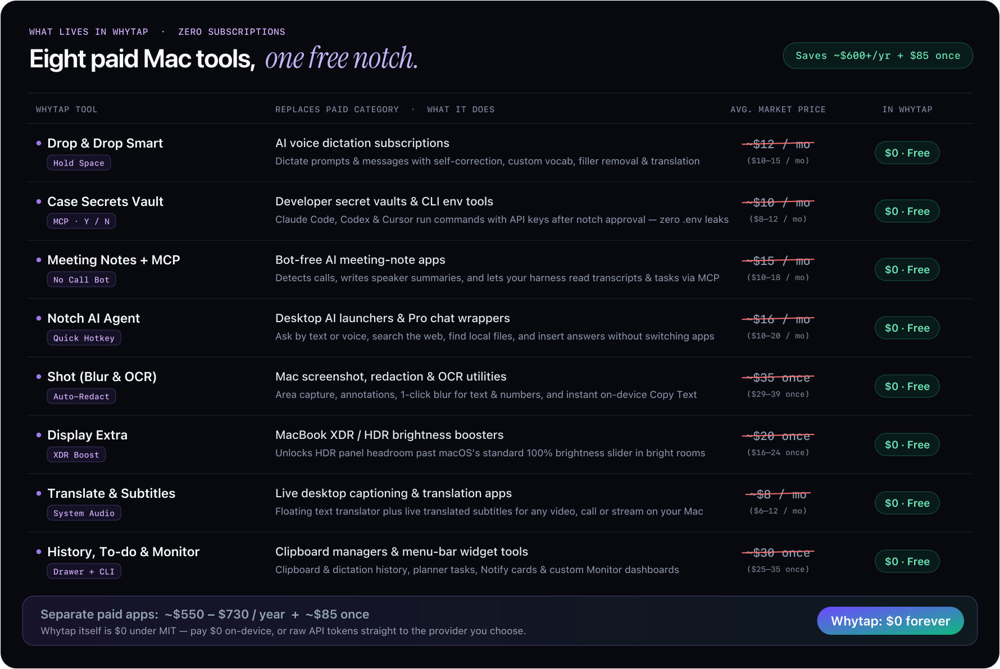
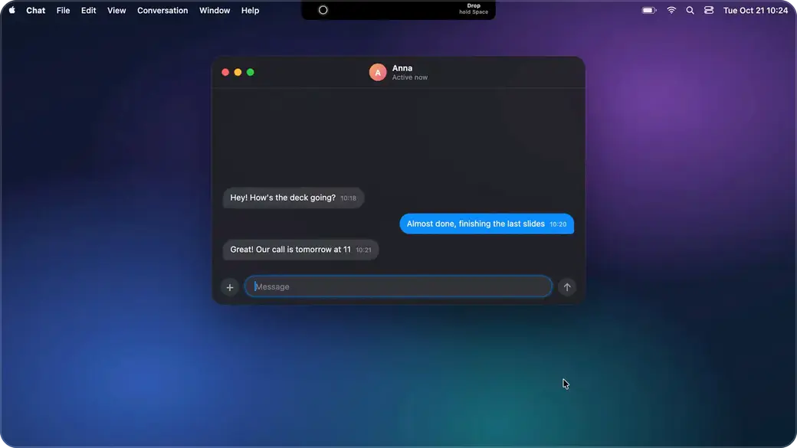

  

<h1 align="center">Whytap</h1>

  <b>The best macOS productivity app, built for your harness.</b> 
  Voice prompts, Case API key vault, bot-free meeting MCP, AI agent, secret blur &amp; HDR — free in your Mac’s notch.

  <a href="https://github.com/AbsoluteMode/whytap/releases/latest/download/Whytap-latest.dmg"><picture><source media="(prefers-color-scheme: dark)" srcset="docs/assets/readme/btn-download-dark.svg"><source media="(prefers-color-scheme: light)" srcset="docs/assets/readme/btn-download-light.svg"></picture></a>&nbsp;&nbsp;<a href="https://whytap.ai"><picture><source media="(prefers-color-scheme: dark)" srcset="docs/assets/readme/btn-site-dark.svg"><source media="(prefers-color-scheme: light)" srcset="docs/assets/readme/btn-site-light.svg"></picture></a>

  <b>macOS 14.2+</b> &nbsp;·&nbsp; <b>Apple Silicon &amp; Intel</b> &nbsp;·&nbsp; <b>Developer ID Signed &amp; Notarized</b> &nbsp;·&nbsp; <b>No Account · Zero Telemetry</b> &nbsp;·&nbsp; <a href="LICENSE"><b>MIT License</b></a>

 

<a href="#watch-every-tool-in-action">
  <picture>
    <source media="(prefers-color-scheme: dark)" srcset="docs/assets/readme/features-table-dark.svg">
    <source media="(prefers-color-scheme: light)" srcset="docs/assets/readme/features-table-light.svg">
    
  </picture>
</a>

 

## Watch every tool in action

Click any row below to watch it right here on GitHub — no external links or page jumps.

<b>Case — API Key Vault for Your Harness</b> &emsp;Replaces ~$10/mo developer secret vaults &nbsp;·&nbsp; <b>$0 in Whytap</b>

 

Store API keys locally in Case. **Claude Code**, **Codex** and **Cursor** discover key names via MCP and run commands with them after a quick <kbd>Y</kbd> / <kbd>N</kbd> approval in your Mac's notch — secret values never enter `.env` files or model context.

  

 

<b>Drop &amp; Drop Smart — Voice Prompts</b> &emsp;Replaces ~$12/mo AI voice dictation apps &nbsp;·&nbsp; <b>$0 in Whytap</b>

 

Hold <kbd>Space</kbd> in any editor, terminal or chat field, speak naturally, and release. **Fast** pastes instantly (for **$0 on-device** with Parakeet v3 on Apple Silicon, or pennies with your speech key); **Smart** removes fillers, keeps self-corrections, and formats lists and paragraphs.

  

 

<b>Output Language &amp; Custom Vocab</b> &emsp;Built into Drop at no extra cost &nbsp;·&nbsp; <b>$0 in Whytap</b>

 

Speak in your native language and paste directly in another with **Output Language**, or teach **Vocab** project names, jargon and handles once so every future take spells them right.

<table>
  <tr>
    <td width="50%" align="center">
      <b>Output Language</b>  
      
    </td>
    <td width="50%" align="center">
      <b>Custom Vocab</b>  
      
    </td>
  </tr>
</table>

 

<b>Meeting Notes + Harness MCP</b> &emsp;Replaces ~$15/mo bot-free meeting apps &nbsp;·&nbsp; <b>$0 in Whytap</b>

 

Whytap notices calls in Zoom, Meet, Teams and Slack without a bot joining the room, captures system + mic audio locally, and writes structured speaker notes and tasks. Approve once to let **Claude Code** or **Codex** read your meeting transcripts and tasks directly over MCP.

  

 

<b>Notch AI Agent — Answers &amp; File Lookup</b> &emsp;Replaces ~$16/mo desktop AI launchers &nbsp;·&nbsp; <b>$0 in Whytap</b>

 

Tap your Agent shortcut to type or hold it to speak. Your chosen model answers right inside the notch, searches the web, locates local files, and lets you open or insert results without leaving your current window.

  

 

<b>Shot — Secret Blur &amp; On-Device OCR</b> &emsp;Replaces ~$35 screenshot &amp; OCR tools &nbsp;·&nbsp; <b>$0 in Whytap</b>

 

Freeze any screen, draw arrows and labels, blur sensitive text and numbers on invoices or keys in a single click, or extract text completely offline with on-device Apple Vision.

  

 

<b>Display Extra — HDR Brightness Boost</b> &emsp;Replaces ~$20 MacBook brightness tools &nbsp;·&nbsp; <b>$0 in Whytap</b>

 

Unlock the full HDR headroom of your MacBook Pro XDR or external HDR display beyond macOS's standard brightness limit, directly from the notch slider.

  

 

<b>Notify &amp; Monitor — Live Notch Dashboards</b> &emsp;Replaces ~$15 menu-bar alert &amp; widget apps &nbsp;·&nbsp; <b>$0 in Whytap</b>

 

Have your coding harness, CI scripts or cron jobs post rich notification cards right beside the notch, and keep live custom JSON/script dashboards one hover away in Monitor.

  

 

<b>History — Clipboard, Dictations &amp; Answers</b> &emsp;Replaces ~$15 clipboard managers &nbsp;·&nbsp; <b>$0 in Whytap</b>

 

Every copied snippet, image, voice dictation and agent answer stays searchable in one local drawer — ready to copy or paste again at any time.

  

