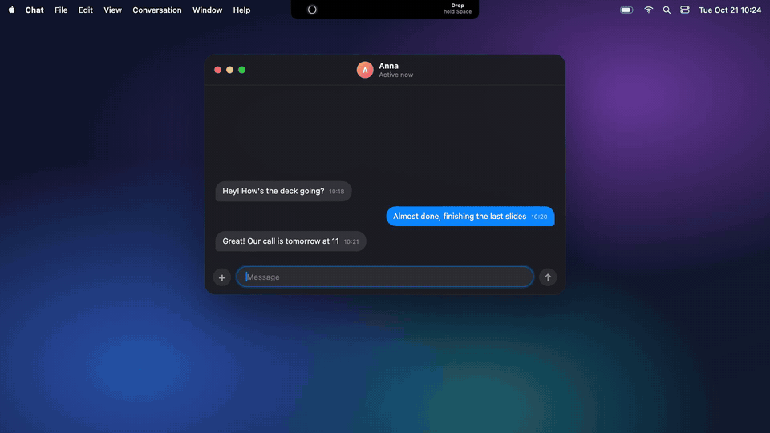

<p align="center">
  
</p>

<h1 align="center">Whytap</h1>

<p align="center">
  <b>One free app in your Mac's notch instead of half a dozen paid subscriptions.</b><br>
  Voice dictation, meeting notes, an AI agent, screenshots, HDR brightness and translation —<br>
  bring your own keys or dictate on this Mac. No account, no servers, no telemetry.
</p>

<p align="center">
  <a href="https://github.com/AbsoluteMode/whytap/releases/latest/download/Whytap-latest.dmg"><b>Download</b></a> ·
  <a href="https://whytap.ai">Website &amp; help</a> ·
  <a href="docs/README.md">Docs</a>
</p>

<p align="center">
  
</p>

## Stop paying for six separate Mac apps

Most of the everyday tools people rent separately on macOS live together in Whytap's notch — free and open source under MIT:

| What people usually pay for | Typical price | Included in Whytap |
|---|---|---|
| **Voice dictation** in any text field | $12–15 / mo | **Drop**: hold <kbd>Space</kbd> in any text field, speak, release. Fast pastes the transcript; Smart lightly edits it with your model. Pennies with your speech key, or $0 on this Mac (Apple Silicon). |
| **AI meeting notes** without a call bot | $15–20 / mo | **Meeting notes**: notices calls in Zoom, Teams, Slack and Google Meet and turns them into a summary with a transcript using your keys. |
| **Quick desktop AI & voice agent** | $10–20 / mo | **Agent**: tap <kbd>Right ⌘</kbd> to type a question or hold it to speak. Reads files, searches the web and answers in the island using your key. |
| **Screenshot editor, text blur & OCR** | $29+ | **Shot**: arrows, text blur and Copy text — built in for free. |
| **Extra XDR / HDR brightness** | $15–25 | **Display Extra**: brighter whites on XDR and HDR displays beyond the usual maximum — built in for free. |
| **Clipboard history, live subtitles, translation & dev tools** | $30–50 / yr | **History** (clipboard, dictations, agent answers), **Translate** & live **Subtitles**, **Case** (secrets vault for Claude Code, Cursor and Whytap Agent), **Notify**, **Vocab**, **To-do**, **Calendar** and **Monitor** dashboards — all built in. |

Instead of **$500+/year** in overlapping Mac utilities, Whytap itself is **$0** — you pay only raw API usage directly to the providers you choose, or nothing at all for on-device dictation and local tools.

## Your keys, your Mac

- Dictate on this Mac with a downloaded speech model: no key, no account, audio never leaves it (Apple Silicon).
- Or use your own keys for Soniox, Deepgram, ElevenLabs, OpenRouter, OpenAI or Anthropic, or your own OpenAI-compatible server. Keys stay in the macOS Keychain.
- Audio and text go only to the provider you chose for that feature. There is no Whytap account, backend or telemetry.
- Free and open source under the MIT license.

What leaves your Mac, and when: [Privacy](docs/privacy.md).

## Install

<a href="https://github.com/AbsoluteMode/whytap/releases/latest/download/Whytap-latest.dmg"></a>

macOS 14.2 or newer, Apple Silicon and Intel. Signed and notarized; updates arrive in the island.
More in [Install and update](docs/install.md).

## Quick start

1. Open Whytap. Hover the island at the top of the screen and click **Settings**.
2. In **Permissions**, allow Microphone and Accessibility. In **API & Models**, download the On this Mac model or add a speech key, then pick a model for Drop.
3. Click into any text field, hold <kbd>Space</kbd>, speak and release.

| Action | Default |
|---|---|
| Dictate into the focused field | hold <kbd>Space</kbd> |
| Ask the agent by text / by voice | tap / hold <kbd>Right ⌘</kbd> |
| Google the selection / your voice | tap / hold <kbd>Right ⌥</kbd> |
| Start or stop a meeting recording | <kbd>⌥</kbd> <kbd>M</kbd> |
| Close the agent answer | <kbd>Esc</kbd> |

Remap any of them, or give any tool its own shortcut, in **Settings → Hotkeys**.

## Help

Questions about setup, a feature or a problem with the app? Ask on [whytap.ai](https://whytap.ai), where you can find more information about Whytap.

## Build from source

Needs Xcode 26 or newer (Swift 6).

```bash
git clone https://github.com/AbsoluteMode/whytap.git
cd whytap
swift test
./scripts/dev-run.sh --run
```

[Build details](docs/build-and-release.md) · [Customize Whytap with your coding agent](docs/customization/README.md)

## Contributing

Bug reports and pull requests are welcome; see [CONTRIBUTING.md](CONTRIBUTING.md).

## Security

Report vulnerabilities to contact@maxbutorin.dev; see [SECURITY.md](SECURITY.md).

## License

[MIT](LICENSE). The Whytap name and icon: [TRADEMARK.md](TRADEMARK.md). Third-party code: [THIRD_PARTY_LICENSES.md](THIRD_PARTY_LICENSES.md).
