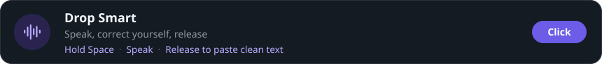
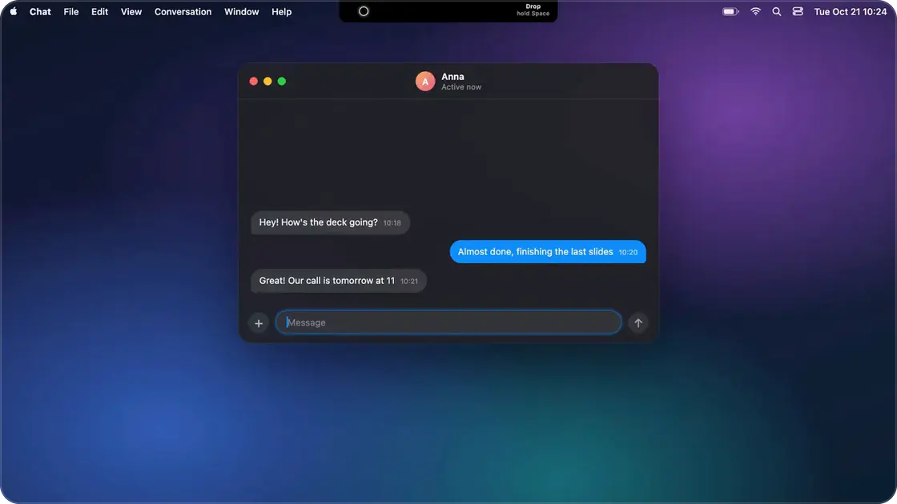
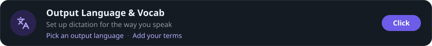
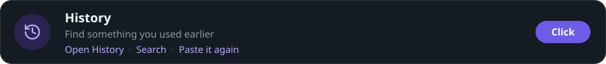
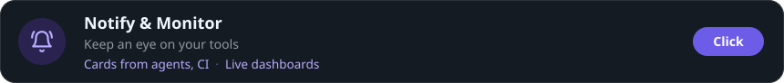
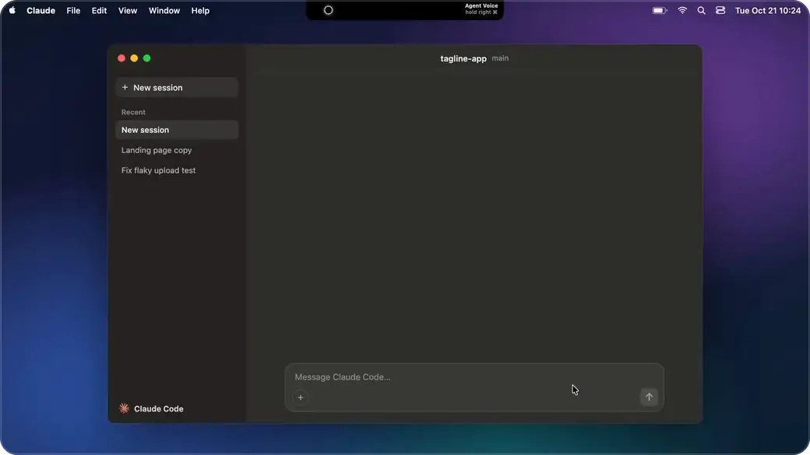
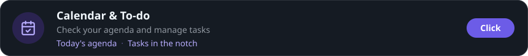
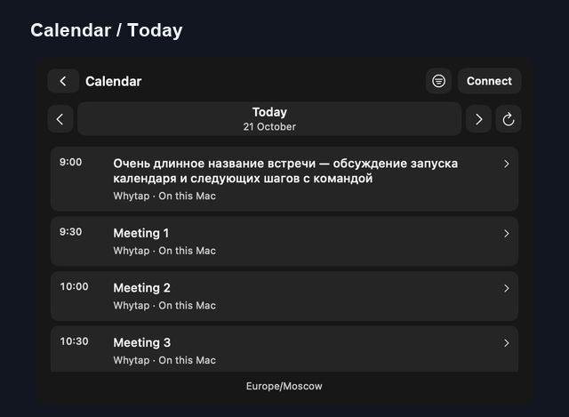
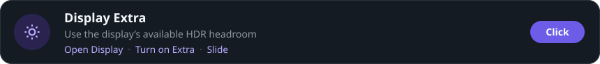

<h1 align="center">&nbsp;Whytap </h1>

  <b>The MacOS productivity app, built for your&nbsp;.</b>

  &nbsp;&nbsp;<a href="https://whytap.ai"><picture><source media="(prefers-color-scheme: dark)" srcset="docs/assets/readme/btn-site-dark.svg"><source media="(prefers-color-scheme: light)" srcset="docs/assets/readme/btn-site-light.svg"></picture></a>

  <b>macOS 14.2+</b> &nbsp;·&nbsp; <b>Apple Silicon &amp; Intel</b> &nbsp;·&nbsp; <b>Developer ID Signed &amp; Notarized</b> &nbsp;·&nbsp; <b>No Account · Zero Telemetry</b> &nbsp;·&nbsp; <b>MIT License</b>

## Watch every tool in action

Click a tool to play its demo. Opening one closes the previous.

<picture><source media="(max-width: 640px) and (prefers-color-scheme: dark)" srcset="docs/assets/readme/demo-card-drop-smart-phone-dark.svg"><source media="(max-width: 640px)" srcset="docs/assets/readme/demo-card-drop-smart-phone-light.svg"><source media="(prefers-color-scheme: dark)" srcset="docs/assets/readme/demo-card-drop-smart-wide-dark.svg"><source media="(prefers-color-scheme: light)" srcset="docs/assets/readme/demo-card-drop-smart-wide-light.svg"></picture>

<picture><source media="(max-width: 640px) and (prefers-color-scheme: dark)" srcset="docs/assets/readme/demo-card-agent-phone-dark.svg"><source media="(max-width: 640px)" srcset="docs/assets/readme/demo-card-agent-phone-light.svg"><source media="(prefers-color-scheme: dark)" srcset="docs/assets/readme/demo-card-agent-wide-dark.svg"><source media="(prefers-color-scheme: light)" srcset="docs/assets/readme/demo-card-agent-wide-light.svg"></picture>

<picture><source media="(max-width: 640px) and (prefers-color-scheme: dark)" srcset="docs/assets/readme/demo-card-case-phone-dark.svg"><source media="(max-width: 640px)" srcset="docs/assets/readme/demo-card-case-phone-light.svg"><source media="(prefers-color-scheme: dark)" srcset="docs/assets/readme/demo-card-case-wide-dark.svg"><source media="(prefers-color-scheme: light)" srcset="docs/assets/readme/demo-card-case-wide-light.svg"></picture>

<picture><source media="(max-width: 640px) and (prefers-color-scheme: dark)" srcset="docs/assets/readme/demo-card-meetings-phone-dark.svg"><source media="(max-width: 640px)" srcset="docs/assets/readme/demo-card-meetings-phone-light.svg"><source media="(prefers-color-scheme: dark)" srcset="docs/assets/readme/demo-card-meetings-wide-dark.svg"><source media="(prefers-color-scheme: light)" srcset="docs/assets/readme/demo-card-meetings-wide-light.svg"></picture>

<picture><source media="(max-width: 640px) and (prefers-color-scheme: dark)" srcset="docs/assets/readme/demo-card-language-vocab-phone-dark.svg"><source media="(max-width: 640px)" srcset="docs/assets/readme/demo-card-language-vocab-phone-light.svg"><source media="(prefers-color-scheme: dark)" srcset="docs/assets/readme/demo-card-language-vocab-wide-dark.svg"><source media="(prefers-color-scheme: light)" srcset="docs/assets/readme/demo-card-language-vocab-wide-light.svg"></picture>

<picture><source media="(max-width: 640px) and (prefers-color-scheme: dark)" srcset="docs/assets/readme/demo-card-shot-phone-dark.svg"><source media="(max-width: 640px)" srcset="docs/assets/readme/demo-card-shot-phone-light.svg"><source media="(prefers-color-scheme: dark)" srcset="docs/assets/readme/demo-card-shot-wide-dark.svg"><source media="(prefers-color-scheme: light)" srcset="docs/assets/readme/demo-card-shot-wide-light.svg"></picture>

<picture><source media="(max-width: 640px) and (prefers-color-scheme: dark)" srcset="docs/assets/readme/demo-card-history-phone-dark.svg"><source media="(max-width: 640px)" srcset="docs/assets/readme/demo-card-history-phone-light.svg"><source media="(prefers-color-scheme: dark)" srcset="docs/assets/readme/demo-card-history-wide-dark.svg"><source media="(prefers-color-scheme: light)" srcset="docs/assets/readme/demo-card-history-wide-light.svg"></picture>

<picture><source media="(max-width: 640px) and (prefers-color-scheme: dark)" srcset="docs/assets/readme/demo-card-notify-monitor-phone-dark.svg"><source media="(max-width: 640px)" srcset="docs/assets/readme/demo-card-notify-monitor-phone-light.svg"><source media="(prefers-color-scheme: dark)" srcset="docs/assets/readme/demo-card-notify-monitor-wide-dark.svg"><source media="(prefers-color-scheme: light)" srcset="docs/assets/readme/demo-card-notify-monitor-wide-light.svg"></picture>

<picture><source media="(max-width: 640px) and (prefers-color-scheme: dark)" srcset="docs/assets/readme/demo-card-calendar-todo-phone-dark.svg"><source media="(max-width: 640px)" srcset="docs/assets/readme/demo-card-calendar-todo-phone-light.svg"><source media="(prefers-color-scheme: dark)" srcset="docs/assets/readme/demo-card-calendar-todo-wide-dark.svg"><source media="(prefers-color-scheme: light)" srcset="docs/assets/readme/demo-card-calendar-todo-wide-light.svg"></picture>

<picture><source media="(prefers-reduced-motion: reduce)" srcset="docs/assets/readme/demo-calendar-todo-still.webp"></picture>

<picture><source media="(max-width: 640px) and (prefers-color-scheme: dark)" srcset="docs/assets/readme/demo-card-display-extra-phone-dark.svg"><source media="(max-width: 640px)" srcset="docs/assets/readme/demo-card-display-extra-phone-light.svg"><source media="(prefers-color-scheme: dark)" srcset="docs/assets/readme/demo-card-display-extra-wide-dark.svg"><source media="(prefers-color-scheme: light)" srcset="docs/assets/readme/demo-card-display-extra-wide-light.svg"></picture>

