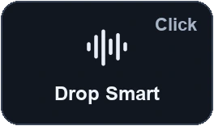
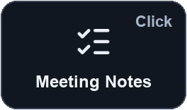
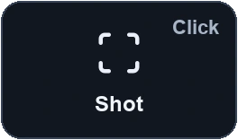
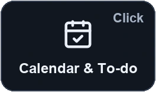
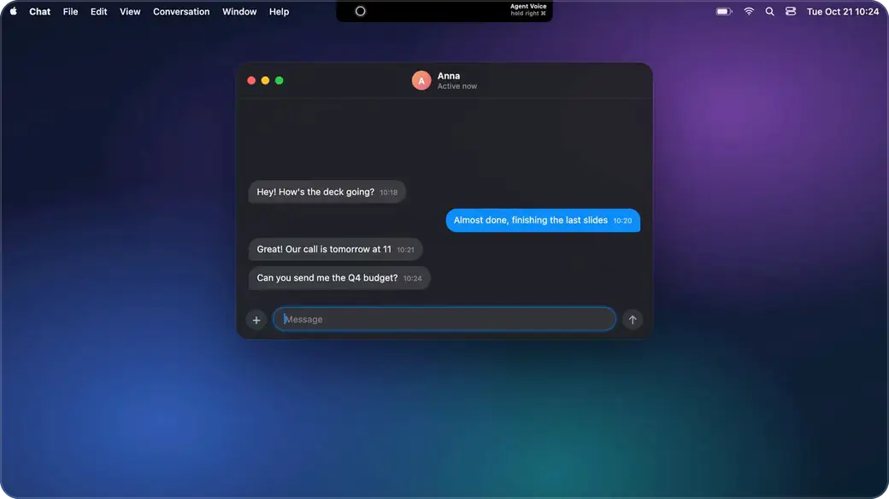

## Watch every tool in action

  
  
  
  
  

  
  
  
  
  

### Agent

<b>Get an answer in the notch</b>

<ol>
  <li>Tap your Agent shortcut to type or hold it to speak.</li>
  <li>Ask a question, search the web, or ask for a local file.</li>
  <li>Open or insert the result from the notch.</li>
</ol>
 
