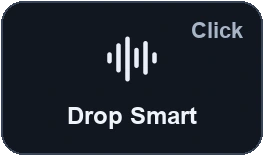
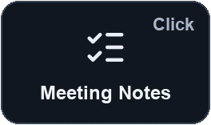
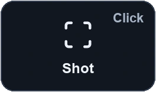
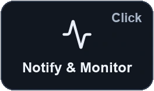
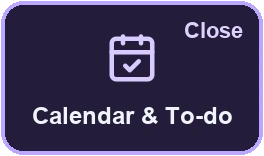
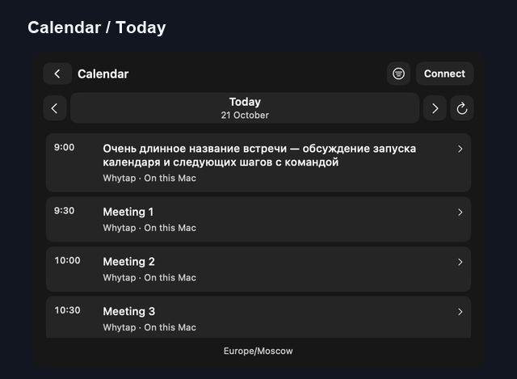

## Watch every tool in action

  
  
  
  
  

  
  
  
  
  

### Calendar & To-do

<b>Check your agenda and manage tasks</b>

<a href="../assets/readme/demo-calendar-todo.gif">
  <picture>
    <source media="(prefers-reduced-motion: reduce)" srcset="../assets/readme/demo-calendar-todo-still.webp">
    
  </picture>
</a>
