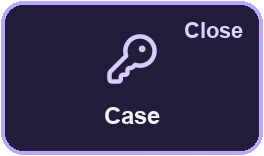
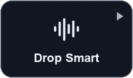
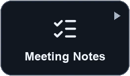
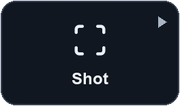
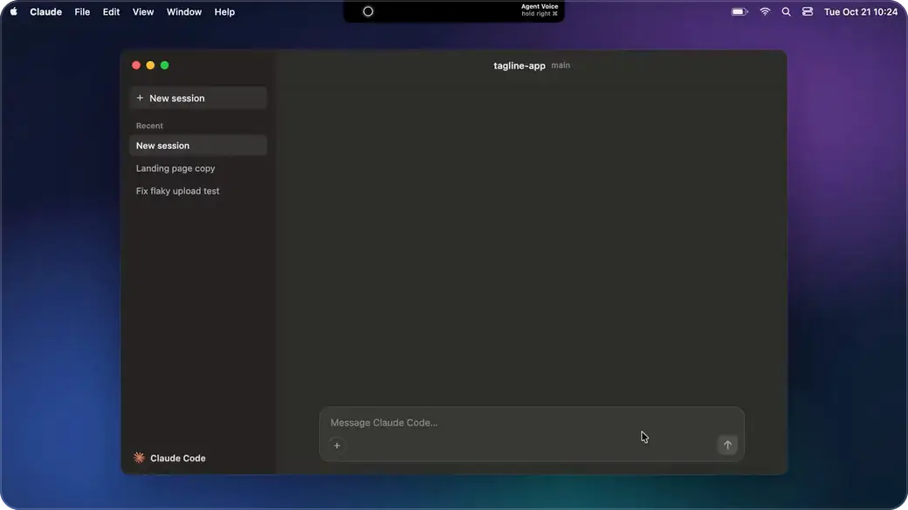

## Watch every tool in action

  
  
  
  
  

  
  
  
  
  

### Case

<b>Approve a command in the notch</b>

<ol>
  <li>Save an API key in Case.</li>
  <li>Request a command from Claude Code, Codex, or Cursor.</li>
  <li>Check the request and choose Allow or Deny.</li>
</ol>

Your coding tool can find key names over MCP. Case passes the secret value to the approved command.

 
