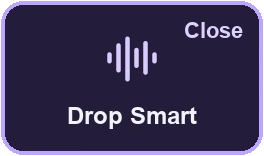
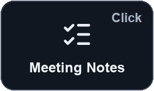
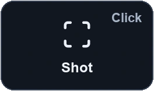

## Watch every tool in action

  
  
  
  
  

  
  
  
  
  

### Drop Smart

<b>Speak, correct yourself, release</b>

<ol>
  <li>Focus a text field and hold <kbd>Space</kbd>.</li>
  <li>Dictate your prompt, including any corrections.</li>
  <li>Release to paste the cleaned-up text.</li>
</ol>

Fast mode pastes the transcript as you said it. On Apple Silicon you can transcribe on your Mac with Parakeet v3, or use your own speech key.

 
