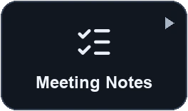
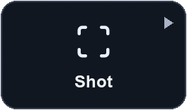
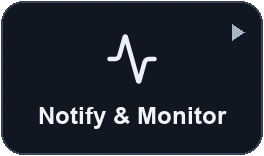
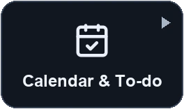
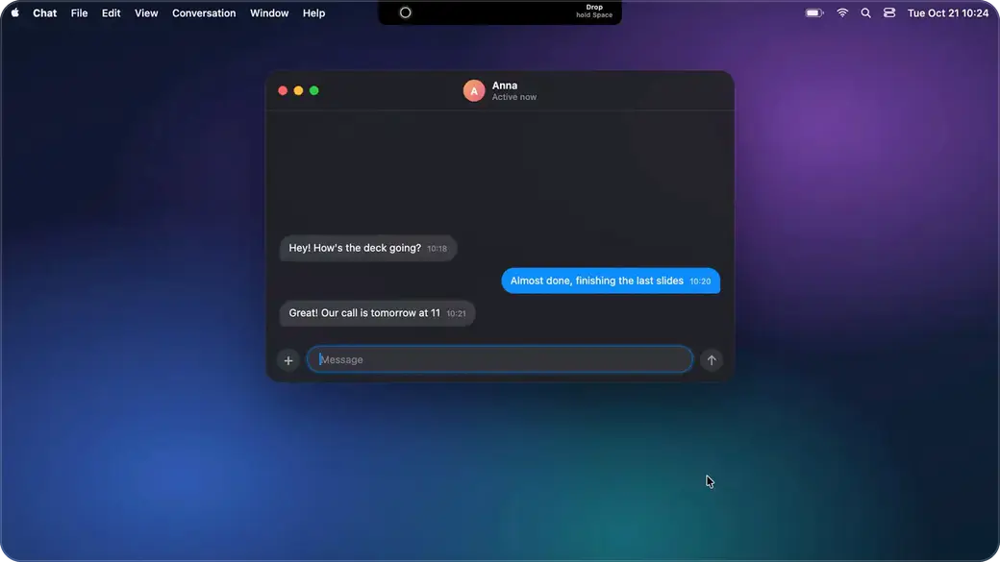

## Watch every tool in action

  
  
  
  
  

  
  
  
  
  

### History

<b>Find something you used earlier</b>

<ol>
  <li>Open History in the notch.</li>
  <li>Search for a copy, dictation, or Agent answer.</li>
  <li>Copy it again or paste it where you’re working.</li>
</ol>
 
