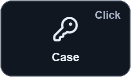
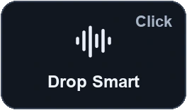
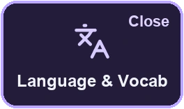
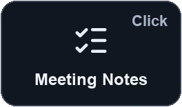
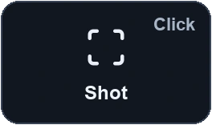
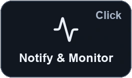
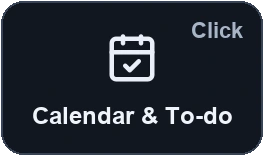
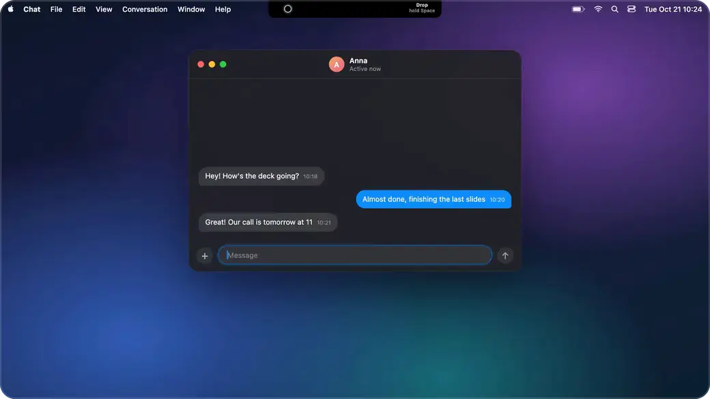

## Watch every tool in action

  
  
  
  
  

  
  
  
  
  

### Output Language & Vocab

<b>Set up dictation for the way you speak</b>

<ol>
  <li>In Smart mode, choose an Output Language to paste in that language.</li>
  <li>Add project names, jargon, or handles in Vocab so Drop can recognize them.</li>
</ol>

<table>
  <tr>
    <td width="50%" align="center">
      <b>Output Language</b>  
      
    </td>
    <td width="50%" align="center">
      <b>Custom Vocab</b>  
      
    </td>
  </tr>
</table>
