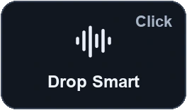
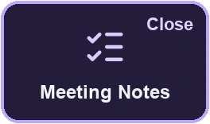
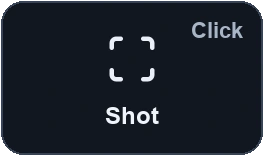
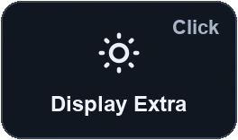
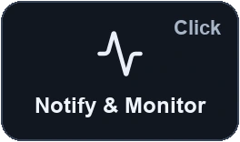
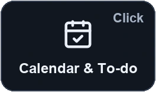
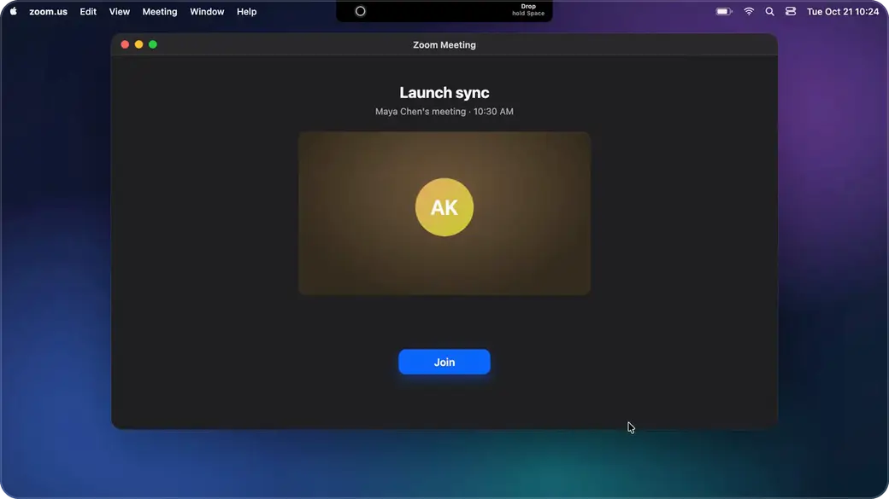

## Watch every tool in action

  
  
  
  
  

  
  
  
  
  

### Meeting Notes

<b>From a call to the next steps</b>

<ol>
  <li>Choose Take notes when Whytap detects your call.</li>
  <li>Stop recording when the call ends.</li>
  <li>Open the summary and review the action items.</li>
</ol>

Works with Zoom, Google Meet, Teams, and Slack without a bot joining the call. After approval, Claude Code or Codex can read the note and transcript over MCP.

 
